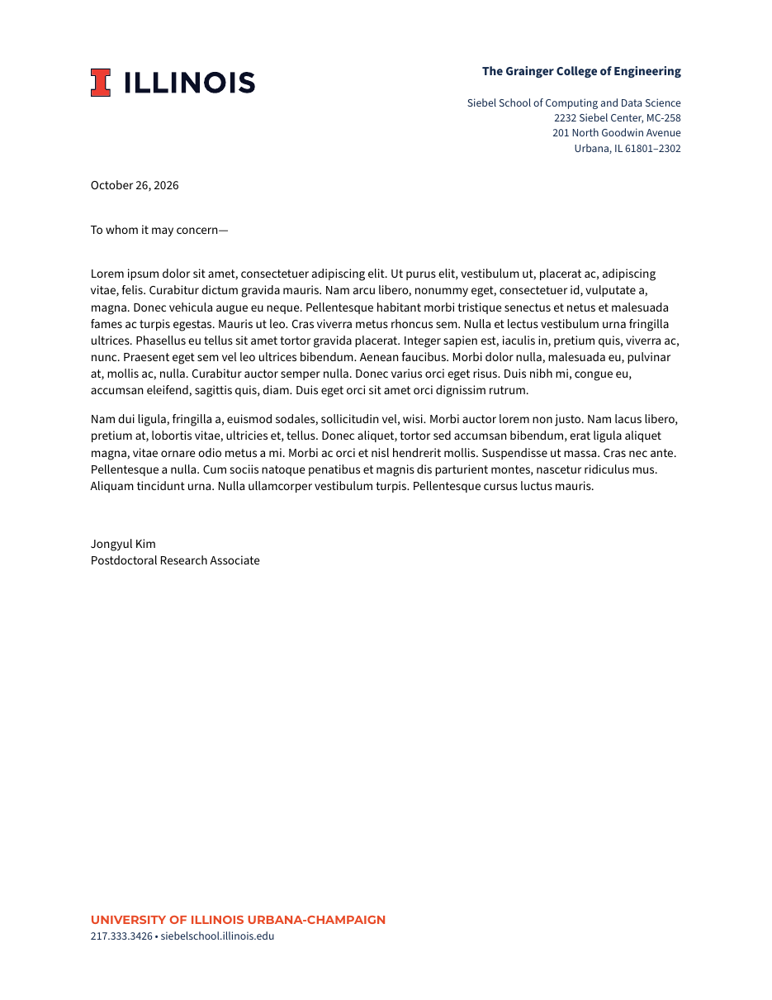

### What is this?

This is a LaTeX reproduction of the current Illinois letterhead (based on [a project](https://github.com/lukeolson/illinois-letterhead) by
[Luke Olson](https://github.com/lukeolson)).

This is the “space-saving” format with "The Grainger College of Engineering" branding and [the block I](https://brand.illinois.edu/visual-identity/wordmarks), designed by Colin Robertson for the Department of Computer Science.

The header and footer follow the [official stationery sample](https://brand.illinois.edu/applying-the-brand/stationery):
the unit block in the header is set in Source Sans (unit name bold, address regular),
the footer's "UNIVERSITY OF ILLINOIS URBANA-CHAMPAIGN" in Montserrat bold caps, and the
contact line below it in Source Sans. The unit block is right-aligned to the body's
right margin, and the page geometry keeps the body clear of the header and footer.

### How do I use it?

The [brand typefaces](https://brand.illinois.edu/visual-identity/typography) are
[Montserrat](https://ctan.org/pkg/montserrat) for headlines and
[Source Sans](https://ctan.org/pkg/sourcesanspro) for body copy; both are included in TeX Live.
The body of the letter is set in Source Sans by default. For a serif body, replace the
"Body font" block in `illinois.tex` with, for example, `\usepackage{newtxtext}`; the header
and footer select their typefaces by family name and are not affected.

To compose a letter, use `template.tex`, which includes the logo and font style through `illinois.tex`, as a guide.
Build with `latexmk -pdf template.tex`.

### What does it look like?

